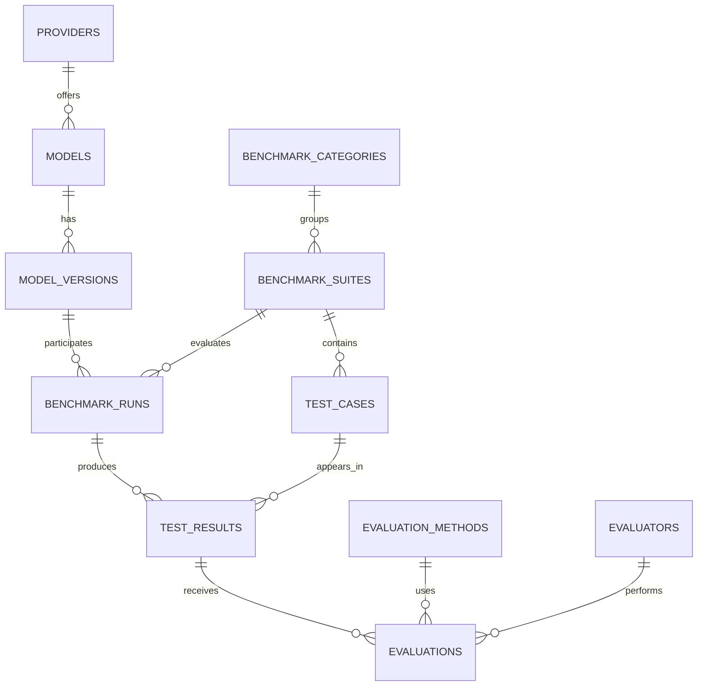

# Design Document: ModelBench

By Your Name  
GitHub: your-github-username | edX: your-edx-username | City, Country

Video overview: <ADD VIDEO URL HERE>

## Scope

ModelBench is a SQLite database for recording and comparing language-model benchmark runs, so a model can be chosen from evidence instead of reputation. It stores providers, models and versions; benchmark categories, suites and test cases; each run; every raw response with its latency, tokens and cost; and the scores that evaluators give those responses.

**In scope:** model catalog, benchmark definitions, runs (including repeats), raw responses, execution failures, multiple evaluators per response, and derived metrics (scores, latency, cost, hallucination rate).

**Out of scope:** calling model APIs or generating responses (an external process inserts the observations), user accounts and permissions, and large binary data. All sample data is synthetic and says nothing about real commercial models.

## Functional Requirements

A user can:

- register providers, models, versions, benchmark suites and test cases;
- record a run, then store each response with its measurements, including errors and timeouts;
- add one or more evaluations per response from rule-based, automated or human evaluators;
- query leaderboards, latency, cost, token use, hallucination rate, difficulty analysis, and evaluator disagreements.

A user cannot rank models by a single stored number, because averages are always computed from the underlying records. Failed executions are kept but never scored.

## Representation

### Entities

| Table | Purpose | Key rules |
|---|---|---|
| `providers`, `models`, `model_versions` | Catalog; versions keep history when a model is updated | unique provider name, `(provider, model)` and `(model, version)` |
| `benchmark_categories`, `benchmark_suites`, `test_cases` | What is tested; each test has its own `max_score` and `difficulty` | unique `(category, suite name)` |
| `benchmark_runs` | One version against one suite, with `attempt_number`, status, configuration, timestamps | unique `(version, suite, attempt)` |
| `test_results` | Raw response, `execution_status` (Success/Error/Timeout), latency, tokens, cost | unique `(run, test case)`; a Success needs a response |
| `evaluation_methods`, `evaluators` | How and by whom a response is judged | unique names |
| `evaluations` | `raw_score`, nullable `hallucination_flag`, notes | unique `(result, method, evaluator)` |

Measurements that are unknown (cost or tokens of a timeout) are stored as `NULL`, not zero, so they never distort sums. `hallucination_flag` is also nullable: `NULL` means "not assessed", which is different from "assessed and clean".

Scores are stored as `raw_score` on each test's own scale. The view `v_evaluation_scores` converts them to 0–100 using `test_cases.max_score`, so the normalized value cannot drift from the raw one and suites with different rubrics stay comparable.

### Relationships

Everything is one-to-many. Raw responses and evaluations are separate on purpose: a response is an observation, a score is an opinion about it, and several evaluators can disagree without overwriting anything.

### Integrity

Foreign keys use `ON DELETE RESTRICT` for catalog data so history cannot be orphaned, and `CASCADE` for runs and results, which are dependent records. `CHECK` constraints limit statuses, difficulties, flags, and non-negative measurements. Triggers enforce what constraints cannot:

- a result's test case must belong to the run's suite (also when a suite is later changed);
- results can only be added to a `Running` run, and a finished run cannot be reopened;
- only `Success` responses can be evaluated, and a `raw_score` cannot exceed the test's `max_score`.

### Views

`v_model_performance` first averages evaluators per response, so each response counts once, then pools responses across completed runs. It counts all attempts as `total_tests` but only scored ones as `evaluated_tests`, excludes `NULL` hallucination flags from that rate's denominator, and averages latency over successful responses only so a 30-second timeout does not distort speed. Averages are left unrounded so later calculations round once, at display. `v_model_leaderboard` ranks versions within a suite by score, then latency.

## Optimizations

Indexes cover the common joins and filters: test cases by suite, results by test case and execution status, runs by suite and status, and evaluations by method and evaluator. `idx_runs_version_date` serves the latest-run report. Composite `UNIQUE` constraints already index their leading columns, so duplicate indexes are omitted. `EXPLAIN QUERY PLAN` confirms the plans: results of a run use `sqlite_autoindex_test_results_1 (run_id=?)`, and the latest run of a version uses a covering search on `idx_runs_version_date`. Views derive every metric from stored observations, so nothing is duplicated and nothing can go stale.

## Limitations

- The 39-response sample is small and synthetic; it demonstrates behavior, not real performance.
- Results depend on prompts, sampling settings, hardware and scoring method. The schema stores configuration as free text and does not enforce comparable conditions.
- Category-level averages pool suites, which is only meaningful when their rubrics are compatible.
- Costs are estimates supplied by whoever enters the data. Timestamps are text and must use ISO format to sort correctly.
- A run need not include every test case in its suite.
- SQLite 3.30+ is required, and there is no authentication or API layer. A future application could add both, along with pricing history and confidence intervals.
