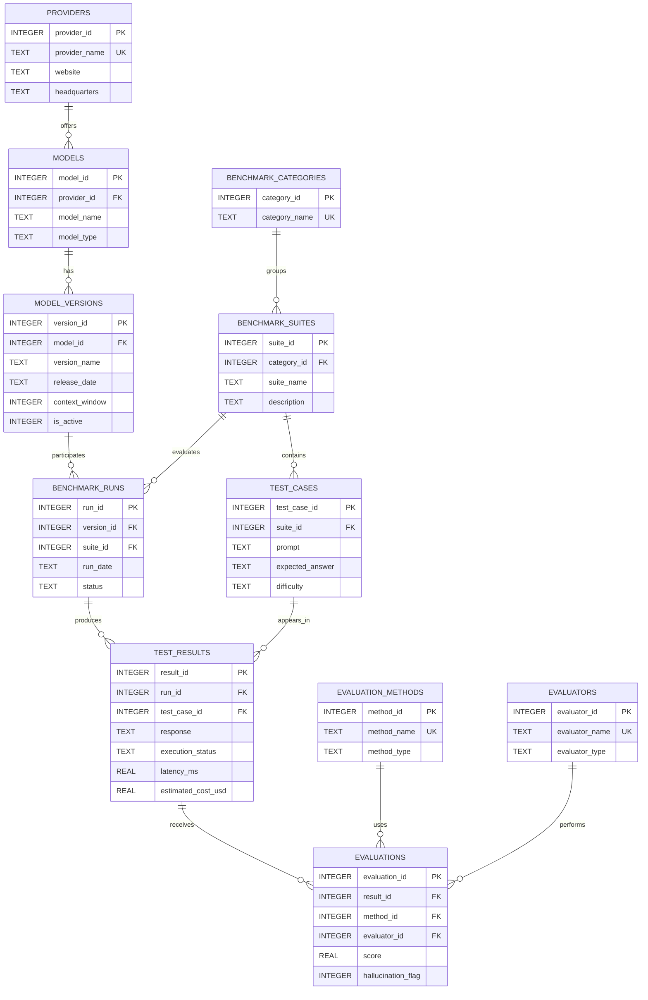

# ModelBench – LLM Evaluation and Benchmarking Database

## Project Overview

**ModelBench** is a relational database for organizing, recording, and comparing the performance of large language models (LLMs). It is designed for developers, researchers, and teams who need a structured way to evaluate models across different tasks instead of selecting a model based only on reputation or informal impressions.

The database stores model providers, model versions, benchmark categories, benchmark suites, individual test cases, benchmark executions, raw model responses, and evaluations of those responses. It also records operational measurements such as response latency, input and output token counts, estimated cost, execution failures, and hallucination flags.

The central idea is to preserve the underlying observations. Rather than storing only a final average for each model, ModelBench stores each test result and its evaluation. SQL queries and views can then calculate comparable metrics from the underlying records.

## 1. Scope and Purpose

The purpose of ModelBench is to answer practical model-selection questions:

- Which model version performs best on a particular coding or reasoning benchmark?
- Which model has the lowest average response latency?
- How much does each benchmark run cost?
- Which models have the highest observed hallucination rate?
- Are some test difficulties consistently harder for all models?
- Do human and automated evaluators disagree about particular responses?

The project is a database-backed benchmarking record system, not an LLM inference service. It does not call model APIs or generate responses itself. Responses and measurements are inserted into the database by a user or an external evaluation process. This keeps the scope appropriate for a SQL-focused project while leaving room for a future application or API integration.

The included demonstration records are synthetic sample data created to exercise the schema and reports. They are not measured results from commercial AI systems and should not be interpreted as a real-world model ranking. The data includes one timed-out request, one deliberately fabricated answer, and one human-versus-rule-based score disagreement so the corresponding reports return examples.

## 2. Entities

The schema contains eleven core entities.

1. **providers** stores organizations that offer AI models. `provider_id` is the primary key, and `provider_name` is unique.
2. **models** stores model-level information and references its provider through `provider_id`. A provider can offer many models. The combination of provider and model name is unique.
3. **model_versions** stores version-specific information, including release date, context window, and active status. Keeping versions separate preserves historical benchmark results when a model is updated.
4. **benchmark_categories** stores broad evaluation areas such as Coding, Reasoning, and Mathematics.
5. **benchmark_suites** stores named collections of tests within a category. Each suite belongs to one category.
6. **test_cases** stores the prompt, expected answer or reference, difficulty, maximum score, and active status for an individual test. Each test case belongs to one suite.
7. **benchmark_runs** represents one execution of a particular model version against one benchmark suite. It records status, dates, configuration, and notes.
8. **test_results** stores the raw response and execution measurements for one test case within a run. It records success, error, or timeout, along with latency, token counts, estimated cost, and any error message.
9. **evaluation_methods** describes how a response is assessed, such as rule-based, automated, or human evaluation.
10. **evaluators** identifies the person or system that performed an evaluation.
11. **evaluations** stores an evaluator's score, hallucination flag, notes, and evaluation timestamp for a test result.

## 3. Relationships and Entity Relationship Diagram

The relationships are primarily one-to-many. A provider can have multiple models; a model can have multiple versions; a category can contain multiple benchmark suites; and a suite can contain multiple test cases. A model version can participate in many benchmark runs, and a suite can be used in many runs.

A benchmark run produces multiple test results, while each test result refers to one test case. The pair `(run_id, test_case_id)` is unique, preventing the same test case from being inserted twice into the same run; a retry is recorded in a new run. A test result can have multiple evaluations, allowing independent human and automated assessments. Each evaluation references one evaluation method and one evaluator, and the combination of result, method, and evaluator is unique.



## 4. Design Decisions and Integrity Constraints

The database uses integer primary keys for compact, stable references. Foreign keys connect related records and are enabled with `PRAGMA foreign_keys = ON`. Most referenced parent records use `ON DELETE RESTRICT` so that providers, models, suites, and test cases cannot be accidentally removed while historical records depend on them. Results and evaluations use cascading deletion from a benchmark run or result because they are dependent records.

`CHECK` constraints restrict model types, benchmark difficulty, run status, execution status, evaluator types, score range, non-negative measurements, and Boolean-style flags. Scores are normalized to the shared 0–100 scale; `test_cases.max_score` records the source rubric's maximum, which an evaluator converts to that scale. `NOT NULL` is applied to fields required for a meaningful record. `UNIQUE` constraints prevent duplicate provider names, duplicate model names within a provider, duplicate versions within a model, duplicate evaluation identities for one result, and duplicate results for the same test case in one run.

Triggers enforce rules that ordinary foreign keys cannot express. A result's test case must belong to the suite selected by its run, both when the result is inserted or updated and when either parent row's suite is changed. Results can be inserted only while their run is `Running`, and an existing result can be moved only into a running run. The parent-update guards prevent a valid result from becoming inconsistent after it has been recorded.

Raw outputs and evaluations are separated deliberately. A response is an observation; a score is an assessment of that observation. This separation supports multiple evaluators and avoids overwriting the original response when an evaluation method changes. Deleting a run cascades to its test results and their evaluations; deleting referenced catalog records is restricted so historical results are preserved.

## 5. Optimizations

Indexes support common joins, filtering, and the latest-run report: test-case suite, run version/date, run suite, run status, result test case and execution status, and evaluation method and evaluator. Several foreign-key indexes are supplied already by composite `UNIQUE` constraints: `(provider_id, model_name)`, `(model_id, version_name)`, `(category_id, suite_name)`, `(run_id, test_case_id)`, and `(result_id, method_id, evaluator_id)`. Separate indexes on those same leading columns would duplicate storage and write work, so they are omitted.

The `v_model_performance` view provides reusable summaries by provider, model version, category, and suite, using completed runs. It first averages multiple evaluations per result, so each response contributes one score and one hallucination value. It then combines response totals and counts across runs before calculating the averages; this weights each evaluated response equally instead of giving a short run the same weight as a long run. `evaluated_tests` counts only results with at least one evaluation, while `total_tests` counts all recorded attempts. Hallucination rate uses evaluated responses as its denominator. When evaluators disagree on a hallucination flag, their average contributes a fractional value for that response.

Latency averages use recorded, non-NULL measurements, including a timeout's measured duration. Token and cost totals sum recorded values and leave unknown values out rather than treating them as zero. `cost_observations` exposes how many costs were recorded. The score-per-dollar query returns a ratio only when every attempt in that model-version/suite row has both a score and a cost; partial cost coverage is not presented as a complete comparison. `v_model_leaderboard` ranks model versions within each suite, with average score first and average latency as the tie-breaker; missing latency sorts last.

The views are derived from stored observations rather than maintaining duplicated aggregate columns. This reduces update anomalies and ensures that reports can be regenerated from the source records. For very large datasets, query plans should be inspected with SQLite's `EXPLAIN QUERY PLAN`, and indexes should be adjusted based on actual workload.

## 6. Typical Usage

A typical workflow begins by registering a provider, model, and model version. A benchmark category and suite are then created, followed by test cases. When an evaluation begins, a `benchmark_runs` row is inserted with status `Running`. Each model response and its execution measurements are stored in `test_results`. One or more evaluators then add scores and hallucination assessments in `evaluations`. When execution is complete, the run is updated to `Completed` and given a completion timestamp.

To load the demonstration in the SQLite command line, open a fresh database and read both files in the same session:

```text
sqlite3 modelbench.db
sqlite> .read schema.sql
sqlite> .read queries.sql
```

Each file enables foreign keys because SQLite applies that setting to a connection, not permanently to the database. `queries.sql` inserts the synthetic records in one transaction and then runs the reports; load it once into a fresh database rather than rerunning it against already-seeded tables.

The reporting queries demonstrate joins across the normalized tables, grouped averages, conditional aggregation, `HAVING`, nested queries, common table expressions, and window functions such as `RANK()` and `ROW_NUMBER()`. The reports include suite leaderboards, score leaders by suite, cost and latency comparisons, token consumption, difficult test cases, evaluator disagreement, and failed executions. Score summaries average evaluators per response before combining responses. Category summaries weight suite rows by their number of evaluated responses; top-case and leaderboard comparisons stay within a suite so tests with different prompts are not ranked against one another.

## 7. Limitations

The sample dataset is small and synthetic. It demonstrates database behavior but cannot establish the real performance of any commercial model. Benchmark results are sensitive to prompt wording, sampling settings, hardware, API load, model updates, and scoring methodology. Comparisons are meaningful only when test conditions are sufficiently consistent. Several reports aggregate category-wide across suites on the shared normalized score scale, so users should confirm that the suites use compatible rubrics before treating those category averages as a ranking.

Scores are stored on a normalized 0–100 scale, but different evaluation methods may not be perfectly comparable. The database records the method and evaluator to preserve this context; users should not combine incompatible scoring methods without a documented policy. Estimated costs depend on the pricing assumptions used by the data-entry process and may not match an invoice. Date/time values are stored as text and should use a consistent ISO-style format for correct lexical ordering. The schema does not enforce a particular sampling configuration or require every test case in a suite to appear in every run.

The current design stores prompts and responses as text. It does not manage large binary datasets, model weights, or full multimodal files. It also does not authenticate users, enforce organizational permissions, or call model APIs. Those responsibilities would belong to a future application layer.

## 8. Possible Future Improvements

Future versions could add dataset provenance, prompt templates, hardware and runtime environments, repeated-run groups, confidence intervals, rubric-level scores, model pricing histories, and API ingestion. A web interface could provide filters and visual comparisons while SQLite remains the initial storage engine. Larger deployments could migrate to a server database with role-based access control and scheduled evaluation jobs.

## 9. Optional Project Demo

A short demo video can introduce ModelBench, show the schema and synthetic dataset, and walk through a suite leaderboard, an evaluator disagreement, and a timeout report. Add a public or unlisted video link here if one is recorded.

## 10. Validation Notes

The schema and seed/reporting SQL were executed together in SQLite 3.50.4 with foreign-key enforcement enabled. All 21 reporting queries ran. Valid run, result, evaluation, and completion operations were accepted; invalid foreign keys, out-of-range scores, negative measurements, duplicate results, cross-suite assignments, edits that would break suite consistency, and inserts into completed runs were rejected. A cascade-delete check removed a run's results and evaluations, and both `PRAGMA foreign_key_check` and `PRAGMA integrity_check` were clean.

An aggregation probe used a short additional run and two evaluations for one response. It confirmed that the performance summary weights responses rather than runs or evaluator rows, and that unevaluated timeouts do not enter the score or hallucination denominator. These checks use synthetic records and do not establish real model performance.
